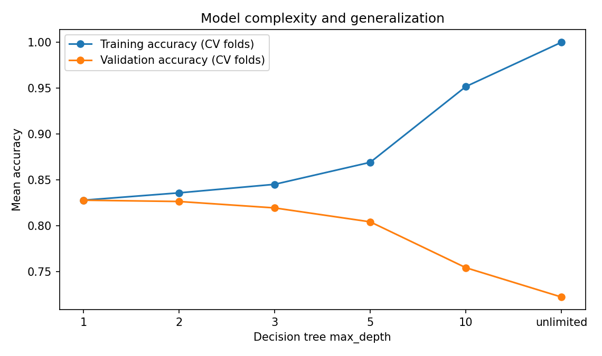

# From Examples to Generalization: An ML Classification Case Study

A reproducible **supervised machine learning case study** and a companion, simplified educational demo. The technical study compares classifiers, tunes hyperparameters using cross-validation, diagnoses overfitting, and examines how incomplete training coverage affects a subgroup. The teaching demo translates the same concepts for a Grades 6–9 audience.

> **Scope:** All pet data are synthetic and deliberately simplistic. The results demonstrate methodology, not real animal recognition or a real-world fairness audit. This is a personal prototype, not an official GIRLsmarts4tech resource.

## What this project demonstrates

| ML concept | Concrete implementation | Why it matters |
|---|---|---|
| Baseline | Majority-class `DummyClassifier` | Establishes a reference beyond which model performance should improve |
| Preprocessing | `StandardScaler` inside `Pipeline` for logistic regression and k-NN | Fits scaling *inside each CV training fold*, preventing preprocessing leakage; distance-based k-NN is scale-sensitive |
| Model selection | Stratified 5-fold `GridSearchCV` over k-NN, logistic regression, and decision trees | Compares models on **validation folds**, not on the final test data |
| Held-out evaluation | 80/20 stratified split, class-specific F1, precision, recall, accuracy, and confusion matrix | Provides an estimate of generalization after model selection |
| Bias–variance / overfitting | Tree depth sweep with noisy training labels and separate train-vs-CV fold scores | Shows why increasing model complexity can hurt validation accuracy |
| Representation gaps | Train with vs. without small dogs, evaluate against the same held-out subgroup | Reveals how training coverage can change subgroup recall |
| Reproducibility | Fixed seeds, automated tests, JSON output, saved diagnostic figure | Makes findings inspectable rather than relying on screenshot claims |

## Results from the default synthetic dataset

Training: **720 samples**; untouched test: **180 samples**. Five-fold CV occurs inside the training split.

| Model | Mean CV dog-class F1 | Held-out dog-class F1 |
|---|---:|---:|
| Majority baseline | 0.000 | 0.000 |
| Logistic regression | 0.935 | 0.929 |
| k-NN | **0.939** | **0.929** |
| Decision tree | 0.936 | 0.916 |

**Selected using training-only CV:** k-NN (`n_neighbors=11`). Held-out test accuracy: **93.3%**, dog-class recall **86.7%** (78 of 90 dogs recognized). The model correctly classified all 90 cats, but mislabeled 12 dogs as cats. This illustrates why accuracy alone is incomplete.

### Overfitting diagnostic



With injected label noise in the separate complexity experiment, the unlimited-depth tree achieves **100% mean fold training accuracy**, versus **72.2% mean CV validation accuracy**. The gap is **27.8 percentage points**, evidence of poor generalization on this deliberately noisy setup. This diagnostic uses only the training split; it does **not** tune models on the final test set.

### Subgroup coverage experiment

On **33 held-out small dogs**, dog-class recall changes from **9.1%** (3/33) when small dogs are excluded from training to **66.7%** (22/33) when they are included. The evaluation group is identical for both conditions. Removing a subgroup also changes training-set size/class balance, so this is a *representation-gap demonstration*, not a controlled estimate of one isolated causal factor.

## Technical Interpretation & Discussion

### Model selection
The k-NN classifier achieved the highest mean cross-validation F1 score, but the differences between k-NN, logistic regression, and decision trees were small. These results do not establish that k-NN is statistically superior. Model selection was based on cross-validation performance rather than test-set results.

### Feature scaling and leakage
k-NN uses distances between observations, so features with larger numerical scales can disproportionately influence predictions. StandardScaler was placed inside a scikit-learn Pipeline so scaling parameters are learned only from the training portion of each cross-validation fold, avoiding preprocessing leakage.

### Overfitting and generalization
Increasing decision-tree complexity raised training accuracy while eventually reducing validation accuracy. This growing generalization gap suggests that the deeper trees were fitting noise rather than learning patterns that generalize to unseen observations.

### Dataset representation
Models trained without small-dog examples performed poorly on that subgroup. Including those examples improved coverage, but this demonstration does not independently establish a causal effect because the training sets differ in composition and size.

### Limitations
All observations are synthetic, with only two numerical features. The findings demonstrate fundamental ML concepts but should not be interpreted as evidence of performance on real-world animal classification tasks.


## Run locally

Python 3.10+ recommended. Use a virtual environment.

```bash
python -m venv .venv
# macOS / Linux: source .venv/bin/activate
# Windows PowerShell: .venv\Scripts\Activate.ps1
python -m pip install -r requirements.txt
python ml_experiments.py
python -m pytest -q
```

Outputs: `reports/results.json` and `reports/tree_complexity.png`. Re-running overwrites these reproducible reports.

For the short student-facing activity, run:

```bash
python classification_demo.py
```

## Project structure

```text
ml-classification-workshop/
├── ml_experiments.py          # Portfolio-grade model comparison & diagnostics
├── classification_demo.py     # Original simplified classroom demonstration
├── tests/test_ml_experiments.py
├── reports/
│   ├── results.json
│   └── tree_complexity.png
├── requirements.txt
└── README.md
```

## Methodological decisions & limitations

- **Data splitting:** Stratify by class to preserve class proportions. Reserve the test set for evaluation rather than hyperparameter decisions.
- **Preprocessing and leakage:** Scale features in `Pipeline`; the scaler is fitted per training fold in cross-validation. Trees require no feature scaling.
- **Model comparison:** Use the same CV partition and selection metric for every candidate. CV scores here are best-configuration scores from the search and can be optimistic; a held-out test helps assess selected-model performance.
- **Precision/recall:** Binary metrics take `dog` as the positive class; the 50/50 class split makes a majority-class accuracy baseline 50%, but F1 is zero when it predicts no dogs.
- **Overfitting experiment:** Inject known synthetic label noise only into the complexity study's training data to expose memorization. The benchmark uses clean labels. The studies have different purposes and should not be interpreted as the same training run.
- **Dataset limitations:** Two numeric features, simplified Gaussian distributions, and small subgroup test counts cannot establish real-world reliability, demographic fairness, or deployment readiness.
- **Next improvements:** Repeated CV / uncertainty estimates, a group-preserving ablation with controlled sample counts, learning curves, additional diagnostics, and better synthetic domain shifts.

## Teaching application

The companion classroom script reduces the concepts to three questions: *How does a model learn? When does it memorize? Who gets left out when training examples are missing?* It is intentionally simpler than the technical experiment. The unfinished team proposal is excluded from this repository.
